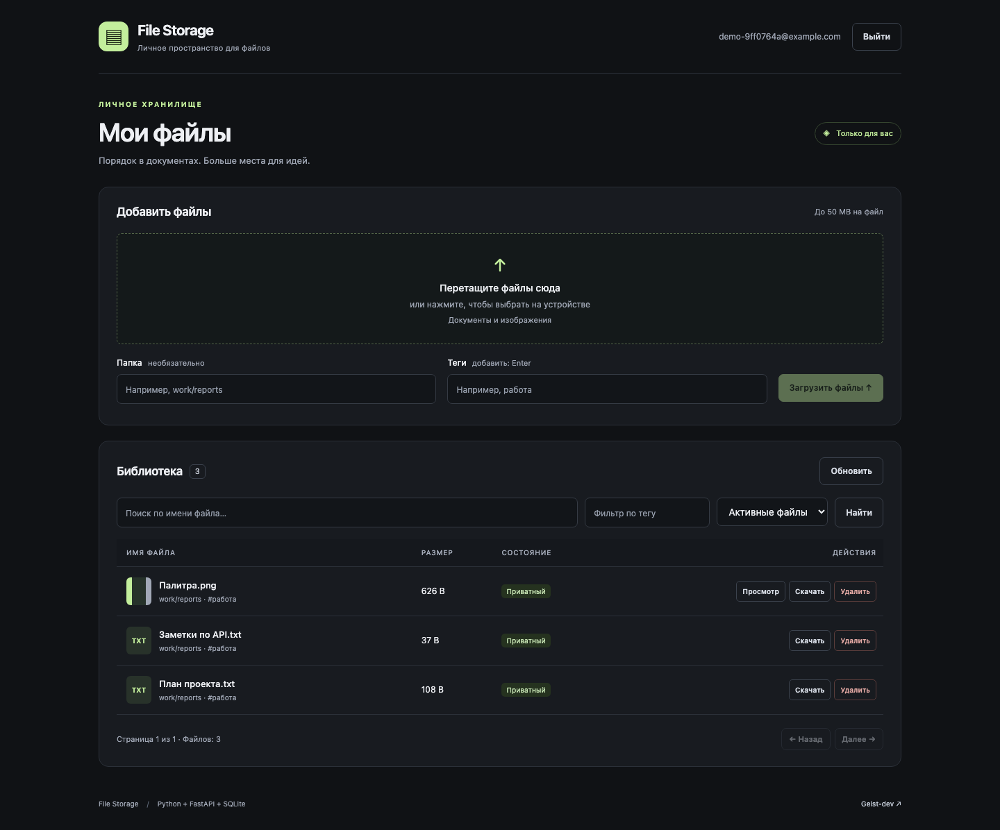
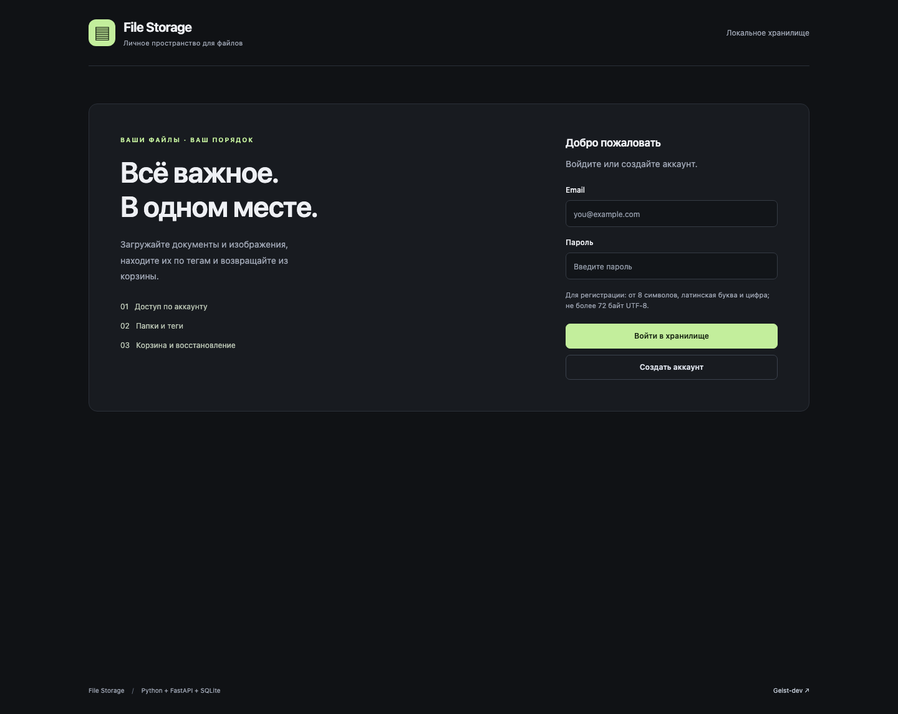
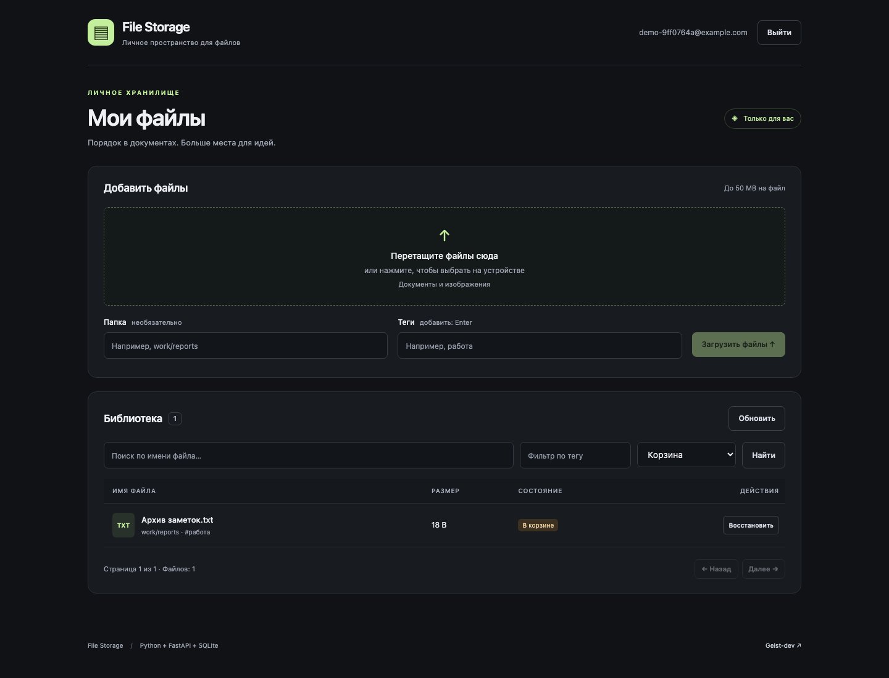
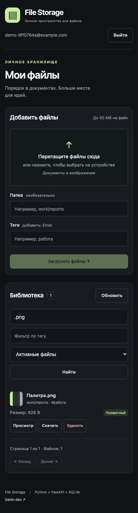

<div align="center">

# File Storage

**Личное пространство для документов и изображений.**

Загрузка · Папки и теги · Поиск · Корзина и восстановление

[](https://www.python.org/)
[](https://fastapi.tiangolo.com/)
[](https://github.com/Geist-dev/File-Storage/actions/workflows/tests.yml)
[](LICENSE)

[Быстрый запуск](#быстрый-запуск-одной-командой) · [Пошаговый запуск](#пошаговый-запуск) · [Скриншоты](#скриншоты) · [Лицензия](#лицензия-и-авторство)

</div>



## Что это

Небольшое файловое хранилище на Python и Vanilla JavaScript. Зарегистрируйтесь, загрузите файлы, добавьте папку и теги. Файлы доступны только своему владельцу; удалённые записи можно вернуть из корзины.

Проект подходит для локального использования и изучения FastAPI. Внешние AI-сервисы, API-ключи, платные подписки и Node.js для работы не нужны.

## Возможности

- Регистрация и вход по email и паролю; пароли хешируются с bcrypt.
- JWT-авторизация и проверка владельца на сервере.
- Выбор нескольких файлов и drag & drop.
- Логические папки, теги, поиск по имени и фильтр по тегу.
- Скачивание исходного файла, миниатюры и просмотр изображений.
- Корзина, восстановление и фильтры «Активные / Корзина / Все».
- Страницы списка и адаптивный интерфейс.
- Ограничение загрузки по размеру и заявленному MIME-типу.
- Один процесс и адрес для интерфейса и API.

## Требования

- Python **3.11–3.14**, включая модуль `venv`.
- Git для клонирования репозитория.
- Интернет при первой установке Python-зависимостей.
- Для bash-скрипта: macOS, Linux или Git Bash на Windows. Для PowerShell есть ручной способ ниже.

На Debian/Ubuntu при ошибке создания окружения установите пакет `python3-venv` через пакетный менеджер системы.

## Быстрый запуск одной командой

Если проект ещё не скачан, выполните в терминале:

```bash
git clone https://github.com/Geist-dev/File-Storage.git && cd File-Storage && bash start.sh
```

В уже скачанном проекте достаточно:

```bash
bash start.sh
```

Скрипт создаст `.venv`, установит зависимости, создаст `backend/.env` с индивидуальным случайным секретом и запустит приложение. Уже существующий `.env` он не изменяет. При повторном запуске использует готовое окружение.

Откройте **http://127.0.0.1:8000**, создайте аккаунт и загрузите файл. Для остановки нажмите **Ctrl+C**. Загрузка файлов не отправляет их во внешние сервисы: они остаются на компьютере, где запущен сервер.

Для выбора интерпретатора:

```bash
PYTHON=python3.12 bash start.sh
```

## Пошаговый запуск

### macOS / Linux / Git Bash

**1. Скачайте проект и перейдите в его папку.**

```bash
git clone https://github.com/Geist-dev/File-Storage.git
cd File-Storage
```

**2. Создайте виртуальное окружение и активируйте его.**

```bash
python3 -m venv .venv
source .venv/bin/activate
```

В Git Bash на Windows используйте `python -m venv .venv` и `source .venv/Scripts/activate`.

**3. Установите зависимости.**

```bash
python -m pip install -r backend/requirements.txt
```

**4. Создайте приватную конфигурацию.**

```bash
python scripts/setup_env.py
```

Будет создан `backend/.env`. Образец всех параметров находится в [`backend/.env.example`](backend/.env.example); не используйте пример секрета как настоящий ключ.

**5. Запустите интерфейс и API.**

```bash
python scripts/serve.py
```

**6. Откройте http://127.0.0.1:8000.** Зарегистрируйтесь, выберите файлы, при необходимости добавьте папку и теги, затем нажмите «Загрузить файлы». Остановите сервер через Ctrl+C.

### Windows PowerShell

Активация окружения не требуется, поэтому изменять политику выполнения PowerShell не нужно:

```powershell
git clone https://github.com/Geist-dev/File-Storage.git
cd File-Storage
py -3 -m venv .venv
.\.venv\Scripts\python.exe -m pip install -r backend/requirements.txt
.\.venv\Scripts\python.exe scripts/setup_env.py
.\.venv\Scripts\python.exe scripts/serve.py
```

Откройте **http://127.0.0.1:8000**. Для остановки — Ctrl+C.

## Скриншоты

Это снимки запущенного приложения с локальными демонстрационными данными.

| Вход и регистрация | Корзина и восстановление |
| --- | --- |
|  |  |

<details>
<summary>Мобильный интерфейс</summary>



</details>

## Конфигурация и данные

Все параметры читаются из `backend/.env`, независимо от текущей папки терминала. Переменные окружения имеют приоритет над файлом.

| Параметр | По умолчанию / назначение |
| --- | --- |
| `APP_HOST` | `127.0.0.1` — доступ с этого компьютера |
| `APP_PORT` | `8000` — порт интерфейса и API |
| `JWT_SECRET` | Случайный секрет, созданный `scripts/setup_env.py`; минимум 32 символа |
| `JWT_EXPIRES_MIN` | `1440` — срок действия токена в минутах |
| `MAX_UPLOAD_MB` | `50` — максимальный размер одного файла |
| `STORAGE_DIR` | `backend/.data/storage` — загруженные файлы и миниатюры |
| `DATABASE_URL` | SQLite в `backend/.data/data.db` — аккаунты и метаданные |
| `ALLOWED_MIME` | JPEG, PNG, WebP, PDF, plain text |

Относительные пути хранилища и SQLite разрешаются от папки `backend/`. Для резервной копии остановите сервер и сохраните `.data/` вместе с приватной конфигурацией. Смена `JWT_SECRET` завершит действие ранее выданных токенов.

`.env`, `.venv`, базы данных и загруженные файлы исключены из Git. **Не публикуйте их вручную и не добавляйте с `git add -f`.**

### Если раньше использовали первоначальную версию

Старая команда могла создавать `data.db` и `storage/` в корне репозитория. Новая версия по умолчанию использует `backend/.data/`, поэтому старые данные автоматически не появятся. Сначала сделайте резервную копию. Для работы с прежними данными задайте в `backend/.env` их абсолютные пути в `DATABASE_URL=sqlite:////absolute/path/data.db` (на Windows — `sqlite:///C:/path/data.db`) и `STORAGE_DIR=/absolute/path/storage`. Старые bcrypt-хеши паролей остаются совместимыми.

## Архитектура

```text
Браузер: HTML / CSS / JavaScript
              │ HTTP, Bearer JWT
              ▼
       FastAPI / Uvicorn
          ├── SQLite: пользователи, метаданные файлов
          ├── Диск: содержимое файлов
          └── Pillow: миниатюры изображений
```

Имена объектов на диске генерируются случайно и не зависят от имени загружаемого файла. Оригинальное имя хранится отдельно для отображения и скачивания. Удаление логическое: запись переходит в корзину, содержимое остаётся на диске.

```text
backend/             API, авторизация, модели, настройки
frontend/            интерфейс без сборки и npm
scripts/setup_env.py  создание локального секрета
scripts/serve.py      запуск приложения
start.sh             автоматическая подготовка и запуск
tests/               API-проверки и браузерный сценарий
docs/screenshots/    снимки запущенного приложения
```

## Проверки

В активированном окружении из корня проекта:

```bash
python -m pip install -r requirements-dev.txt
python -m pytest -q
```

Проверяются доступ владельца и изоляция аккаунтов, скачивание исходных байтов, корзина и восстановление, ограничения загрузки, миниатюры, пароли, некорректные токены, фильтры и страницы списка. Тесты используют отдельную временную БД и не затрагивают ваши данные.

Для проверки настоящего браузера сначала запустите приложение, затем в другом терминале:

```bash
python -m pip install playwright
python -m playwright install chromium
python tests/browser_smoke.py
```

Сценарий создаёт новый демонстрационный аккаунт в локальном приложении и проверяет регистрацию, загрузку, скачивание, предпросмотр, поиск, теги, корзину, восстановление, страницы списка, мобильную ширину и выход. Для обновления скриншотов: `python tests/browser_smoke.py --screenshots`. Адрес другого порта можно передать первым аргументом.

## Ограничения

- Это локальный pet-проект. По умолчанию сервер слушает только loopback; публикация в интернете требует отдельной настройки HTTPS, защиты от перебора паролей, квот и резервного копирования.
- MIME-тип берётся из запроса, это не антивирусная проверка и не полноценная проверка содержимого файла.
- Файлы на диске не зашифрованы приложением. Владелец сервера имеет к ним доступ.
- JWT хранится в `sessionStorage` текущей вкладки; кнопка «Выйти» удаляет его из браузера, но не отзывает уже скопированный токен на сервере.
- Публичные ссылки, массовые операции, постоянное удаление, восстановление пароля и Docker пока не реализованы.
- Папки логические; поддерживаются латинские символы, цифры, пробелы, `/`, `_` и `-`.

## Если что-то не запускается

- **Python не найден:** установите подходящую версию; при необходимости задайте `PYTHON=python3.12`.
- **Порт занят:** измените `APP_PORT` в `backend/.env` и перезапустите сервер. Интерфейс использует тот же адрес, править JS не нужно.
- **Ошибка секрета:** удалите только строку-заглушку и задайте случайный секрет длиной от 32 символов. Если в файле ещё нет нужных настроек, сохраните копию `.env`, удалите исходный и выполните `python scripts/setup_env.py`.
- **Файл больше лимита:** измените `MAX_UPLOAD_MB` и перезапустите сервер либо выберите меньший файл.
- **Вкладка закрылась:** войдите снова; данные на сервере сохраняются.

## Лицензия и авторство

**Copyright (c) 2025–2026 Geist-dev.** Исходный проект: [github.com/Geist-dev/File-Storage](https://github.com/Geist-dev/File-Storage).

Проект распространяется по [лицензии MIT](LICENSE). Можно использовать, изменять, распространять и продавать копии, сохраняя уведомление об авторских правах **Geist-dev** и полный текст лицензии в копиях или существенных частях кода. MIT не требует постоянно показывать имя автора в интерфейсе и не передаёт автору исходного проекта права на чужие изменения.

Лицензии сторонних библиотек действуют отдельно. Не удаляйте их уведомления при распространении зависимостей.

---

Автор: [Geist-dev](https://github.com/Geist-dev) · [Telegram](https://t.me/flipgood)
